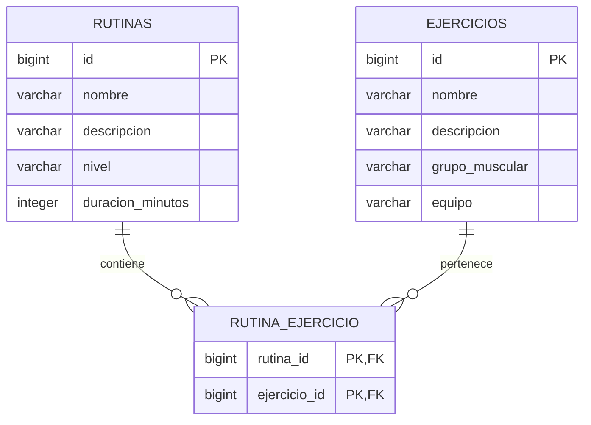

# Gimnasio Sara

API REST y frontend para administrar **ejercicios** y **rutinas**, con relación **muchos a muchos (N:N)**. Incluye CRUD completo, validación, PostgreSQL persistente, migraciones Flyway, imagen Docker y una colección de Postman para probar el despliegue público en AWS.

## Tecnologías

- Java 17, Spring Boot (versión en `pom.xml`), Spring MVC, Spring Data JPA y Jakarta Validation.
- PostgreSQL 17 y Flyway; H2 exclusivamente para pruebas automatizadas.
- HTML, CSS y JavaScript, servidos por Spring Boot en el mismo origen que la API.
- Docker multietapa; ejecución con usuario sin privilegios y comprobación de salud.

## Iniciar en Docker Desktop

Requisito: Docker Desktop iniciado con contenedores Linux. No necesitas instalar Maven, Java o PostgreSQL para esta opción.

```powershell
# Solo si todavía no tienes .env:
Copy-Item .env.example .env
# Edita .env y asigna una contraseña propia a DB_PASSWORD.
docker compose up -d --build --wait
docker compose ps
```

Abre **http://localhost:8080**. La interfaz permite crear, consultar, editar y eliminar ambas entidades; al editar una rutina seleccionas sus ejercicios con casillas. Incluye búsqueda, indicadores, confirmación de borrado y mensajes de error. La biblioteca empieza vacía para ingresar tus propios datos.

En Windows también puedes ejecutar `.\iniciar-docker.cmd`: inicia juntos la aplicación y PostgreSQL desde la carpeta correcta, construye la imagen si hace falta y espera a que ambos estén saludables. No requiere cambiar la política de ejecución de PowerShell.

### Si aparece «Connection to localhost:5432 refused»

Este proyecto usa el **escenario B: aplicación y PostgreSQL dentro de Docker Compose**. La conexión del contenedor es `jdbc:postgresql://db:5432/gimnasio` (o el nombre de base definido en `DB_NAME`). Compose inyecta esa dirección mediante `DB_URL` y espera a que PostgreSQL esté saludable antes de iniciar Java.

El botón **Run** de una imagen en Docker Desktop crea un contenedor aislado: no inicia el servicio `db` ni aplica automáticamente las variables y la red de `compose.yaml`. Lo mismo sucede con un `docker run` que omita esa configuración. En ese caso la aplicación puede usar el valor de desarrollo `localhost` y fallar. El archivo `.env` lo lee Compose; Spring Boot no lo carga por sí solo.

Para iniciar este proyecto usa `.\iniciar-docker.cmd` o `docker compose up -d --build --wait --wait-timeout 240`. Después puedes detener y arrancar **el grupo `gimnasio-sara` completo** desde Docker Desktop. No necesitas cambiar la URL a `host.docker.internal`, porque PostgreSQL está en el servicio `db`. Si usas RDS en AWS, configura `DB_URL` con el endpoint real de RDS.

Comprueba la conexión con `docker compose ps` (ambos servicios deben aparecer saludables), `docker compose logs --tail 60 app db` y `http://localhost:8080/actuator/health` (estado `UP`). Conserva el volumen existente: no ejecutes `docker compose down -v` para resolver este error.

Si ya se generó un `.env` durante la preparación del proyecto, conserva ese archivo: contiene una contraseña aleatoria. Está excluido de Git y del contexto de Docker.

```powershell
# Construir y cargar explícitamente en Docker Desktop:
docker build --load -t gimnasio-sara:1.0.0 -t gimnasio-sara:latest .
docker image ls gimnasio-sara
docker compose logs -f app
docker compose stop
# Quita los contenedores, conserva la base de datos:
docker compose down
```

La base de datos usa el volumen `postgres_data` y no publica el puerto 5432. `docker compose down -v` elimina también los datos. Si cambias DB_PASSWORD después de inicializar PostgreSQL, debes cambiar también la contraseña del usuario dentro de la base: editar `.env` por sí solo no actualiza el volumen existente. Si 8080 está ocupado, cambia `APP_PORT` en `.env`.

## Arquitectura en capas

```text
Frontend (static/index.html, styles.css, app.js)
    ↓ HTTP / JSON
controller → service → repository → PostgreSQL
                ↕           ↕
               dto        entity
exception → respuestas de error consistentes
```

Código Java en `src/main/java/com/example/gimnasio_sara/`:

| Capa | Responsabilidad |
| --- | --- |
| `controller` | Endpoints, códigos HTTP y validación de entrada |
| `service` | Reglas de negocio, transacciones y asociaciones |
| `repository` | Acceso a datos mediante Spring Data JPA |
| `entity` | Mapeo del modelo relacional |
| `dto` | Contratos JSON; evita referencias circulares al serializar entidades |
| `exception` | Errores 400, 404 y conflictos 409 |

Flyway crea el esquema con `src/main/resources/db/migration/V1__crear_gimnasio.sql`. Hibernate valida el esquema; no lo modifica al iniciar.

## Relación N:N



Una rutina contiene varios ejercicios y un ejercicio puede pertenecer a varias rutinas. La tabla intermedia tiene clave primaria compuesta para impedir duplicados. Una rutina puede estar vacía. Borrar una rutina conserva los ejercicios; borrar un ejercicio retira sus asociaciones y conserva las rutinas. No se utiliza `CascadeType.REMOVE` entre las dos entidades.

## Contrato de la API

Prefijo `/api`. `PUT` reemplaza todos los campos del recurso; no hay actualización parcial. En una rutina, `ejercicioIds` reemplaza el conjunto de asociaciones. Las listas se ordenan por ID y no tienen paginación.

| Método | Ruta | Resultado |
| --- | --- | --- |
| GET | `/api/ejercicios` | Listar, 200 |
| GET | `/api/ejercicios/{id}` | Consultar, 200 |
| POST | `/api/ejercicios` | Crear, 201 y cabecera Location |
| PUT | `/api/ejercicios/{id}` | Actualizar, 200 |
| DELETE | `/api/ejercicios/{id}` | Eliminar, 204 |
| GET | `/api/rutinas` | Listar, 200 |
| GET | `/api/rutinas/{id}` | Consultar con ejercicios, 200 |
| POST | `/api/rutinas` | Crear, 201 y Location |
| PUT | `/api/rutinas/{id}` | Actualizar y reemplazar asociaciones, 200 |
| DELETE | `/api/rutinas/{id}` | Eliminar, 204 |
| PUT | `/api/rutinas/{id}/ejercicios/{ejercicioId}` | Asociar sin duplicar, 200 |
| DELETE | `/api/rutinas/{id}/ejercicios/{ejercicioId}` | Desasociar, 204 |
| GET | `/actuator/health` | Salud de aplicación y base de datos |

Crear o actualizar un ejercicio:

```json
{
  "nombre": "Sentadilla",
  "descripcion": "Flexiona las rodillas manteniendo la espalda neutra.",
  "grupoMuscular": "Piernas",
  "equipo": "Peso corporal"
}
```

Crear o actualizar una rutina (usa IDs que existan en tu base):

```json
{
  "nombre": "Fuerza de cuerpo completo",
  "descripcion": "Sesión de fuerza general.",
  "nivel": "PRINCIPIANTE",
  "duracionMinutos": 45,
  "ejercicioIds": [1, 2]
}
```

`nivel`: `PRINCIPIANTE`, `INTERMEDIO` o `AVANZADO`. Duración entre 1 y 600 minutos. Nombres hasta 100 caracteres, descripción hasta 1000, grupo muscular hasta 80 y equipo hasta 100; los textos son obligatorios y no pueden contener solo espacios. Máximo 100 ejercicios por solicitud de rutina. `ejercicioIds: []` crea una rutina vacía; un ID inexistente produce 404 y la transacción no cambia las asociaciones previas.

Ejercicio de respuesta: `id`, `nombre`, `descripcion`, `grupoMuscular`, `equipo`, `rutinaIds`. Rutina de respuesta: `id`, `nombre`, `descripcion`, `nivel`, `duracionMinutos`, `ejercicios` (objetos con los detalles de cada ejercicio).

Ejemplo de error:

```json
{
  "timestamp": "2026-10-23T15:00:00Z",
  "status": 400,
  "mensaje": "Revisa los campos enviados",
  "ruta": "/api/ejercicios",
  "errores": {"nombre": "must not be blank"}
}
```

400: datos inválidos; 404: recurso inexistente; 409: conflicto de integridad. Los mensajes concretos de Jakarta Validation dependen de la configuración regional.

## Pruebas automatizadas

La construcción de la imagen ejecuta `mvn verify`, incluidas cinco pruebas de integración HTTP contra Spring Boot y H2 en modo PostgreSQL: CRUD, relación N:N, borrado seguro, asociación idempotente, validaciones, rollback, frontend y salud. Una prueba fallida impide crear la imagen.

Validación realizada el 23 de octubre de 2026: **5 pruebas de integración correctas** y ejecución de la colección mediante Newman contra **Docker Desktop + PostgreSQL**, con **30 peticiones y 43 aserciones, sin fallos**. Esta comprobación se realizó en el contenedor local; las pruebas contra AWS deben ejecutarse después de publicar el servicio. El reporte de esa ejecución queda en `postman/reports/docker-verificacion.json`, excluido de Git.

Para ejecutarlas con Java 17 o superior instalado:

```powershell
.\mvnw.cmd verify
```

Para desarrollar sin contenedor de aplicación, inicia PostgreSQL, configura `DB_URL`, `DB_USER` y `DB_PASSWORD` en las variables de entorno de tu configuración de ejecución de IntelliJ y ejecuta `GimnasioSaraApplication`. Spring Boot no lee automáticamente `.env`; ese archivo lo utiliza Docker Compose.

## Pruebas JSON del despliegue AWS

**Para el Docker local que está funcionando en el puerto 8080**, importa `postman/Gimnasio-Sara-Local-8080.postman_collection.json`, selecciona **No environment** y abre la colección **Gimnasio Sara - Local 8080**. Sus direcciones están completas y no dependen de `baseUrl`. Consulta `postman/LEEME.md` si no aparece la colección o si usas Postman web.

Archivos importables en Postman:

- `postman/Gimnasio-Sara-AWS.postman_collection.json`: 30 peticiones ordenadas, con aserciones.
- `postman/AWS.postman_environment.json`: entorno reutilizable, configurado actualmente con el puerto 8080 de Docker Compose.

Importa ambos y selecciona el entorno **Gimnasio Sara · AWS**. La colección y el entorno usan actualmente `baseUrl=http://localhost:8080`, que coincide con `APP_PORT=8080` de Docker Compose. Para probar AWS, cambia `baseUrl` en el entorno por la URL **real** publicada, sin barra final ni `/api`, por ejemplo `https://gym.tudominio.com` o `http://IP_PUBLICA_EC2:8080`. Ejecuta toda la colección en orden mediante Collection Runner. Los IDs se capturan de las respuestas; no depende de datos previos ni IDs fijos. Si ya habías importado los archivos, vuelve a importarlos o actualiza también el valor de `baseUrl` en tu entorno de Postman.

La colección comprueba salud, frontend, ambos CRUD, relación N:N en los dos sentidos, asociación repetida, desasociación, errores, rollback y conservación de entidades al borrar asociaciones. Crea registros propios y los elimina al terminar; una ejecución interrumpida puede dejarlos en la base.

También puedes usar Newman con Node.js instalado:

```powershell
npx.cmd --yes newman run postman/Gimnasio-Sara-AWS.postman_collection.json -e postman/AWS.postman_environment.json --env-var "baseUrl=https://TU-DOMINIO-REAL" --reporters cli,json --reporter-json-export postman/reports/aws-resultados.json
```

El reporte solo acredita pruebas en AWS si `baseUrl` apunta efectivamente al despliegue AWS. No se incluyen resultados de un despliegue remoto que aún no existe.

## Desplegar en AWS

Para **EC2 con Nginx y una base RDS existente**, usa `deploy/server/docker-compose.yml` y sigue `deploy/server/README.md`. Esa carpeta permite ejecutar `docker compose up --build -d` después de configurar su `.env` con los datos reales de RDS. El `compose.yaml` de la raíz sigue siendo la opción con PostgreSQL en Docker para desarrollo.

### Opción A: EC2 con Docker Compose

1. Crea una instancia Linux **x86_64** con memoria suficiente para la aplicación y PostgreSQL (para una demostración, considera al menos 2 GB). Instala Docker Engine y Docker Compose siguiendo la documentación de la distribución.
2. Copia el proyecto a EC2 sin `.env` ni credenciales. Crea `.env` allí con una contraseña nueva.
3. Ejecuta `docker compose up -d --build --wait`. Alternativamente, carga la imagen ya construida con `docker save gimnasio-sara:1.0.0 -o gimnasio-sara.tar`, copia el archivo a EC2 y ejecuta `docker load -i gimnasio-sara.tar` y `docker compose up -d --no-build --wait`.
4. En el Security Group permite SSH solo desde tu IP y TCP 8080 desde las IP que utilizarán la demostración. PostgreSQL permanece dentro de la red de Docker. Para un dominio público con HTTPS, configura un ALB con certificado ACM y destino HTTP:8080; permite ese puerto desde el Security Group del ALB.
5. Comprueba `http://IP_PUBLICA:8080/actuator/health`, abre el frontend y ejecuta la colección con esa URL real.

Esta opción guarda los datos en el volumen de la instancia. Prepara copias de seguridad; terminar la instancia o borrar su almacenamiento puede perder los datos.

### Opción B: ECR + ECS Fargate + RDS PostgreSQL

Se incluye `deploy/ecs-task-definition.example.json` como plantilla, no como infraestructura ya creada.

1. Con AWS CLI autenticada y permisos de ECR, publica la imagen desde PowerShell:

   ```powershell
   powershell.exe -NoProfile -ExecutionPolicy Bypass -File .\scripts\publish-ecr.ps1 -AccountId 123456789012 -Region us-east-1
   ```

   El comando permite ejecutar ese script solo en el proceso de PowerShell indicado, sin cambiar la política global. El script comprueba la cuenta activa, crea el repositorio si falta, etiqueta y publica `gimnasio-sara:1.0.0`. Ejecutarlo modifica tu cuenta AWS y transfiere la imagen.
2. Crea RDS PostgreSQL, una base `gimnasio` y un usuario con permisos para crear el esquema mediante Flyway. Ubica RDS en subredes privadas y permite 5432 únicamente desde el Security Group de ECS.
3. Guarda la contraseña como texto en Secrets Manager. Reemplaza `ACCOUNT_ID`, `RDS_ENDPOINT`, región, imagen y ARN del secreto en una copia de la plantilla. `DB_URL` usa TLS con `sslmode=require`.
4. Crea el grupo CloudWatch `/ecs/gimnasio-sara` en la región elegida. El rol de ejecución de ECS necesita permisos para ECR, CloudWatch y `secretsmanager:GetSecretValue` sobre el secreto (y `kms:Decrypt` si aplica).
5. Registra la definición con `aws ecs register-task-definition --cli-input-json file://deploy/ecs-task-definition.json`. Crea clúster y servicio Fargate con esa tarea, red, subredes y Security Groups. En subredes privadas, configura NAT o los endpoints VPC necesarios para ECR, S3, CloudWatch y Secrets Manager.
6. Asocia un ALB público con target group tipo **IP**, puerto 8080 y health check `/actuator/health`. Configura listener HTTPS:443 y certificado ACM para tu dominio; en ECS permite 8080 solo desde el ALB. Usa un período de gracia de salud de al menos 180 segundos.
7. Usa el dominio HTTPS real en `baseUrl` y ejecuta Postman/Newman. No necesitas otro despliegue para el frontend: viene dentro de la misma imagen.

Variables de la aplicación:

| Variable | Uso |
| --- | --- |
| `DB_URL` | URL JDBC de PostgreSQL |
| `DB_USER` | Usuario de base de datos |
| `DB_PASSWORD` | Contraseña; obligatoria, sin valor incorporado en la imagen |
| `PORT` | Puerto interno; 8080 por defecto |
| `JAVA_TOOL_OPTIONS` | Ajustes JVM opcionales |

La API no incluye autenticación ni roles. Es una base funcional para entrega o demostración; si administrará información real o estará abierta al público, añade control de acceso. Los recursos AWS y su facturación se administran desde tu cuenta; este repositorio no crea ni publica automáticamente recursos.

Referencias oficiales: [Spring Boot](https://docs.spring.io/spring-boot/4.0/system-requirements.html), [variables en ECS](https://docs.aws.amazon.com/AmazonECS/latest/developerguide/taskdef-envfiles.html) y [secretos en ECS](https://docs.aws.amazon.com/AmazonECS/latest/developerguide/specifying-sensitive-data.html).
